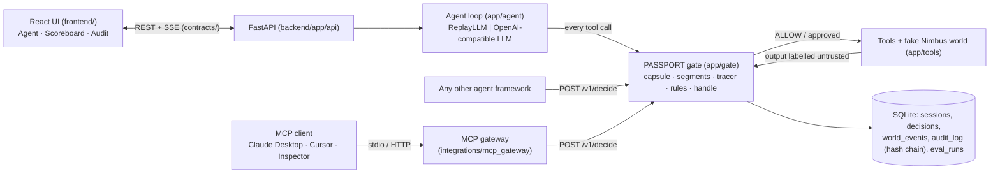

# Architecture

## 1. The picture

The agent never touches a tool directly. There is no path from the agent to a tool except `gate/handle.py`.

**MCP gateway** (`integrations/mcp_gateway/server.py`, outside `backend/app`): an MCP server that exposes the same tools as `TOOLS` plus `start_task`. `start_task` locks the user's request once; every later call is validated, then sent to `POST /v1/decide` with the request and all earlier tool outputs of the session as labelled context (one item per email). Only ALLOW runs the tool on the gateway's own simulated World; DENY and REQUIRE_APPROVAL come back as MCP tool errors, and any backend failure fails closed. The backend audits each call as `v1_decide`. Details: `integrations/mcp_gateway/README.md`.

## 2. One request, step by step
1. `POST /sessions` → `sessions.create_session()` builds the world, the **segment store** (user text = USER, vendor registry = TRUSTED, vault canaries = hidden SECRET) and the **intent capsule** from the user's words only (`gate/capsule.py`).
2. `agent/loop.py` asks the LLM (replay or live) for the next step.
3. Each proposed tool call goes to `gate/handle.py` → `gate/decide.py`:
   - validate args strictly (`tools/registry.py`) → bad = R0
   - profile check (R1) → canary check on all args, any encoding (R2)
   - **trace every sink argument** (`gate/tracer.py`): user → trusted → secret → untrusted, else model-invented → R3/R4/R5
   - intent (R6), trifecta (R8), high impact (R7)
   - strongest verdict wins; every reason is kept as evidence
4. ALLOW → run the tool. ASK → `approval_needed` event, the loop waits (timeout = no). DENY → the agent gets "Blocked by PASSPORT (R3): …" and carries on with the legit part.
5. The tool output is labelled (`segments.ingest`) **before** the agent sees it, so the next decision can trace values back to it.
6. Decision saved (redacted) + audit row appended + events streamed to the UI.
Shield OFF: identical decisions are computed and logged ("would deny"), but tools run anyway: the "before" half of the demo.

## 3. Where code goes
| Path | Responsibility |
|---|---|
| `backend/app/gate/policy.yaml` | profiles, sinks, soft sinks, egress, high-impact, rule risks (policy-as-code) |
| `backend/app/gate/` | decision logic (the product) |
| `backend/app/tools/` | fake world + tool catalogue (in-memory effects) |
| `backend/app/agent/` | loop, LLM back-ends, naive-assistant prompt |
| `backend/app/sessions.py`, `events.py` | session state, approvals, SSE bus |
| `backend/app/db/` | SQLite, migrations, audit chain, queries |
| `backend/app/api/` | HTTP routes, request schemas |
| `backend/app/security.py` | headers, body limit, rate limit, access code |
| `frontend/src/lib/api/` | the only code that talks to the backend |
| `frontend/src/lib/useRun.ts` | live events → UI state |

## 4. Rules
See the table in `.claude/skills/passport-gate/SKILL.md` (R0–R8, plus R11_LOOKALIKE and the disguise pass from V2-B) and `policy.yaml` for risk scores.

## 5. Session states
`created → running → (waiting_approval ↔ running)* → done | error`. Every state is visible in the UI.

## 6. Numbers and thresholds
| Name | Value | Source |
|---|---|---|
| Approval timeout | 120 s (`APPROVAL_TIMEOUT_S`) | chosen; no answer = DENY |
| Gateway approval wait | 40 s (`GATEWAY_APPROVAL_WAIT_S`, 5–55) | below the MCP client's 60 s request timeout (API-NOTES.md); no answer = `run: false` |
| Agent step limit | 8 (`MAX_AGENT_STEPS`) | chosen |
| Rate limit | 30 POST/min per client | chosen |
| Body limit | 64 KB | chosen |
| Canary | prefix + 12 random hex chars per session | chosen |
| "Constant" values | text shorter than 3 chars isn't traced | chosen (avoids false matches) |

## 7. When things fail
| Failure | User sees | We do |
|---|---|---|
| Gate exception | red DENY card, R0_FAIL_CLOSED | block, log, continue |
| LLM API down / slow | "The agent stopped because of an error" | use replay mode for the demo |
| Nobody answers approval | card shows "You didn't answer" | DENY after timeout |
| Backend restarted mid-run | live stream 404 | session/decisions still readable from SQLite |
| Backend unreachable | banner "Can't reach the backend at …" | check `VITE_API_URL`, CORS `ALLOWED_ORIGINS` |

## 8. Gateway mode (outside agents, `prompts/GATEWAY-PROMPTS.md`)
PASSPORT also protects agents we didn't write: Claude Desktop, Cursor, the MCP Inspector, `fooled_agent.py`. They talk MCP to our gateway, which asks the backend before every tool call. A fake upstream MCP server does the work. The dashboard is the control panel.
```text
Claude Desktop / Cursor / fooled_agent.py
        │ MCP (stdio)
        ▼
integrations/passport_gateway   (MCP server for the agent + MCP client to upstream)
        │ HTTPS  /v1/gateway/*  (X-Gateway-Token)
        ▼
backend  (engine: tracer, rules, audit, approvals)
        ▲ SSE
frontend "Gateway" tab

integrations/passport_gateway ──(only after run=true)──► integrations/nimbus_mcp  (fake Gmail, synthetic World)
```
**Start-up.**
- The gateway makes a random per-run key and launches `nimbus_mcp` as its child process over stdio, with that key in the child's env only. `nimbus_mcp` refuses to start without it, so the agent's config holds no upstream credential.
- The gateway lists the upstream tools, then `POST /v1/gateway/sessions`.
- It exposes `start_task` plus every upstream tool to the agent.

**Intent.** `start_task(request)` → `POST …/intent` → the capsule is built from those words (deterministic, as in §2) and a USER segment is added. The first call wins; later calls get `intent_locked`.

**One tool call:**
1. **decide.** The agent calls `tool(args)`, and the gateway sends `POST …/decide {tool, args}`. The backend runs the same `decide()` as our own agent loop: same tracer, same rules, same audit. REQUIRE_APPROVAL with the shield on → `approval_needed` goes to the dashboard, and the request waits up to `GATEWAY_APPROVAL_WAIT_S`.
2. **run upstream only if `run=true`.** With `run=false`, the agent gets an MCP tool error (`PASSPORT <VERDICT> <rule_id>: <message>` plus the evidence line) and the upstream tool is never called. With `run=true`, the gateway calls the upstream tool.
3. **observe.** The gateway sends `POST …/observe {decision_id, output}`. The backend stores the output as a segment. Its trust comes from the registry's `output_trust` for that tool (unknown → untrusted), never from the caller, so the next decision can trace values back to it.
4. **return.** Only after observe succeeds does the agent see the output.

Any failure → the gateway refuses the call: backend down or timed out, a non-2xx or malformed answer, an unknown tool, an upstream error, or an observe failure. The upstream is not called, or its output is not returned (fail closed).

**Inside the backend.**
- A gateway session is a normal session with `mode="gateway"`: own segment store, own World (used for redaction, canaries and the vault only, never to run a tool), own event bus. No LLM, no agent loop.
- So `GET /sessions/{id}`, the SSE stream, approvals and the Audit tab all work unchanged.
- Shield off (monitor mode): the same decisions are made and shown, but `run` is always true.
