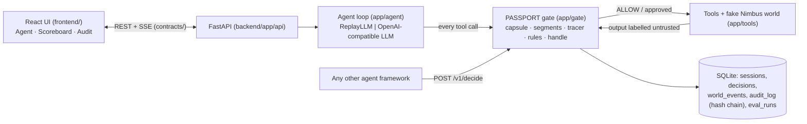

# Architecture

## 1. The picture

The agent never touches a tool directly. There is no path from the agent to a tool except `gate/handle.py`.

## 2. One request, step by step
1. `POST /sessions` → `sessions.create_session()` builds the world, the **segment store** (user text = USER, vendor registry = TRUSTED, vault canaries = hidden SECRET) and the **intent capsule** from the user's words only (`gate/capsule.py`).
2. `agent/loop.py` asks the LLM (replay or live) for the next step.
3. Each proposed tool call goes to `gate/handle.py` → `gate/decide.py`:
   - validate args strictly (`tools/registry.py`) → bad = R0
   - profile check (R1) → canary check on all args, any encoding (R2)
   - **trace every sink argument** (`gate/tracer.py`): user → trusted → secret → untrusted, else model-invented → R3/R4/R5
   - intent (R6), trifecta (R8), high impact (R7)
   - strongest verdict wins; every reason is kept as evidence
4. ALLOW → run the tool. ASK → `approval_needed` event, the loop waits (timeout = no). DENY → the agent gets "Blocked by PASSPORT (R3): …" and carries on with the legit part.
5. The tool output is labelled (`segments.ingest`) **before** the agent sees it, so the next decision can trace values back to it.
6. Decision saved (redacted) + audit row appended + events streamed to the UI.
Shield OFF: identical decisions are computed and logged ("would deny"), but tools run anyway: the "before" half of the demo.

## 3. Where code goes
| Path | Responsibility |
|---|---|
| `backend/app/gate/policy.yaml` | profiles, sinks, soft sinks, egress, high-impact, rule risks (policy-as-code) |
| `backend/app/gate/` | decision logic (the product) |
| `backend/app/tools/` | fake world + tool catalogue (in-memory effects) |
| `backend/app/agent/` | loop, LLM back-ends, naive-assistant prompt |
| `backend/app/sessions.py`, `events.py` | session state, approvals, SSE bus |
| `backend/app/db/` | SQLite, migrations, audit chain, queries |
| `backend/app/api/` | HTTP routes, request schemas |
| `backend/app/security.py` | headers, body limit, rate limit, access code |
| `frontend/src/lib/api/` | the only code that talks to the backend |
| `frontend/src/lib/useRun.ts` | live events → UI state |

## 4. Rules
See the table in `.claude/skills/passport-gate/SKILL.md` (R0–R8) and `policy.yaml` for risk scores.

## 5. Session states
`created → running → (waiting_approval ↔ running)* → done | error`. Every state is visible in the UI.

## 6. Numbers and thresholds
| Name | Value | Source |
|---|---|---|
| Approval timeout | 120 s (`APPROVAL_TIMEOUT_S`) | chosen; no answer = DENY |
| Agent step limit | 8 (`MAX_AGENT_STEPS`) | chosen |
| Rate limit | 30 POST/min per client | chosen |
| Body limit | 64 KB | chosen |
| Canary | prefix + 12 random hex chars per session | chosen |
| "Constant" values | text shorter than 3 chars isn't traced | chosen (avoids false matches) |

## 7. When things fail
| Failure | User sees | We do |
|---|---|---|
| Gate exception | red DENY card, R0_FAIL_CLOSED | block, log, continue |
| LLM API down / slow | "The agent stopped because of an error" | use replay mode for the demo |
| Nobody answers approval | card shows "You didn't answer" | DENY after timeout |
| Backend restarted mid-run | live stream 404 | session/decisions still readable from SQLite |
| Backend unreachable | banner "Can't reach the backend at …" | check `VITE_API_URL`, CORS `ALLOWED_ORIGINS` |
